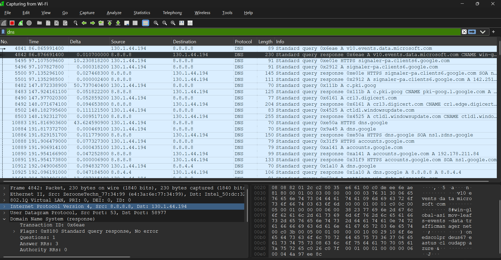
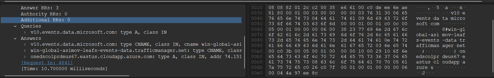

# 🔐 DNS Traffic Analysis Using Wireshark

## 📌 Project Overview
This project focuses on capturing and analyzing Domain Name System (DNS) traffic using Wireshark. It demonstrates how DNS queries and responses work and how domain names are resolved into IP addresses.

## 🎯 Objective
To capture, inspect, and analyze DNS query and response packets to understand the DNS resolution process.

## 🛠️ Tools & Technologies
- Wireshark
- DNS (Domain Name System)
- IPv4
- UDP
- Network Packet Analysis

## 🔬 Methodology
1. Opened Wireshark and selected the active Wi-Fi network interface.
2. Started capturing live network traffic.
3. Applied the DNS display filter (`dns`).
4. Identified DNS query and response packets.
5. Inspected source and destination IP addresses.
6. Analyzed DNS A and CNAME resource records.
7. Observed the DNS response time.

## 📊 Observations

| Parameter | Observation |
|---|---|
| Domain Name | v10.events.data.microsoft.com |
| DNS Server | 8.8.8.8 |
| Query Type | A |
| Answer Resource Records | 3 |
| Authority Resource Records | 0 |
| Additional Resource Records | 0 |
| Response Time | 10.7 ms |
| Transport Protocol | UDP |

### 🔍 Packet Analysis

- Captured DNS query and response packets.
- Identified client IP address: 130.1.44.194.
- Identified DNS server IP address: 8.8.8.8.
- Observed CNAME records in the DNS response.
- Identified the final A record in the answer section.
- Analyzed three Answer Resource Records.
- Observed a DNS response time of approximately 10.7 milliseconds.

## 📷 Screenshots

### 1. DNS Query and Response Capture

### 2. DNS Packet Details

## 📚 Key Learnings

- Understanding the DNS resolution process.
- Identifying DNS queries and responses.
- Understanding A and CNAME records.
- Analyzing source and destination IP addresses.
- Inspecting network packets using Wireshark.
- Understanding DNS response time.

## ✅ Result

Successfully captured and analyzed DNS communication using Wireshark and gained practical knowledge of DNS resolution, packet analysis, and network communication.

## 👨‍💻 Author

**Bishal Baniya**

Cybersecurity | IoT | Network Security

## 🏷️ Technologies & Tags

`Wireshark` `DNS` `Cybersecurity` `NetworkSecurity` `PacketAnalysis` `Networking`
